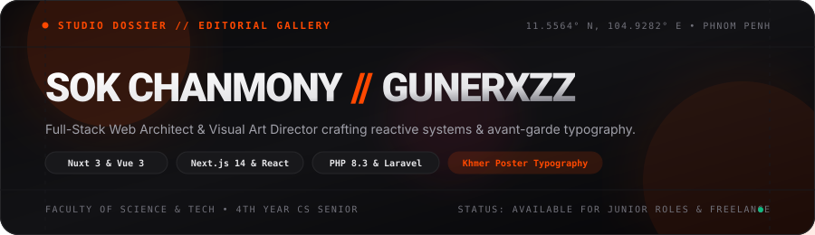
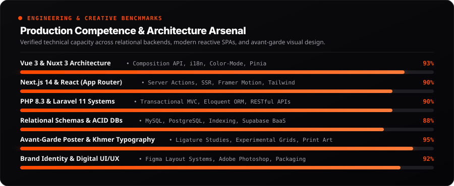
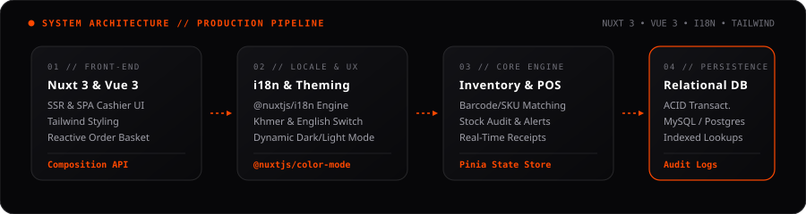

<div align="center">

<!-- ======================================================== -->
<!-- 1. BESPOKE EDITORIAL VECTOR HERO BANNER                   -->
<!-- ======================================================== -->
<a href="https://gunerxzz.github.io/My-Portfolio/">
  
</a>

<br/><br/>

<!-- ======================================================== -->
<!-- 2. ANIMATED DYNAMIC TYPING SVG                           -->
<!-- ======================================================== -->
<a href="https://github.com/GunerXzz">
  
</a>

<br/>

<!-- ======================================================== -->
<!-- 3. INTERACTIVE PILL NAVIGATION BADGES                    -->
<!-- ======================================================== -->
<p align="center">
  <a href="https://gunerxzz.github.io/My-Portfolio/" target="_blank">
    
  </a>
  &nbsp;
  <a href="https://github.com/GunerXzz?tab=repositories" target="_blank">
    
  </a>
  &nbsp;
  <a href="mailto:sokchanmony.dev@gmail.com">
    
  </a>
  &nbsp;
  <a href="https://t.me/sokchanmony" target="_blank">
    
  </a>
  &nbsp;
  
</p>

---

</div>

## ⚡ Editorial Manifesto & Developer Spec

```typescript
interface DeveloperDossier {
  name: "Sok Chanmony";
  alias: "GunerXzz";
  status: "4th-Year Computer Science Senior (Class of 2026)";
  institution: "Faculty of Science & Technology";
  coordinates: "Phnom Penh, Cambodia 🇰🇭 (GMT+7 ICT)";
  coreDualDisciplines: {
    engineering: "Full-Stack Web (Nuxt 3 / Vue, Next.js / React, PHP, Laravel, MySQL, Supabase)";
    visualArt: "Avant-Garde Poster Composition, Khmer Typography Ligatures, E-Commerce Packaging";
  };
  manifesto: "Clean architectures on the server, reactive web apps on the front, and striking poster typography in Figma & Photoshop.";
  statusRadar: "Available for Junior Software Engineer Contracts, Full-Stack Roles & Freelance Design";
}
```

---

## 🎯 Production Competencies & Benchmarks

<!-- Replaced standard GitHub commit stats with rich technical benchmark matrix -->
<div align="center">
  
</div>

---

## 🏗️ Flagship Architecture Blueprint: POS & Management Platform

<!-- System Architecture breakdown showcasing real engineering rigor -->
<div align="center">
  
</div>

---

## 🚀 Featured Deployments & Open-Source Repositories

<table>
  <tr>
    <td width="50%" valign="top">
      <h3 align="left">
        <a href="https://github.com/GunerXzz/Pos-and-Managment-System">
          🛒 POS &amp; Store Management System
        </a>
      </h3>
      <p><b>Enterprise Retail Point of Sale &amp; Real-Time Inventory Platform</b></p>
      <p>A reactive POS terminal engineered with Nuxt 3, Vue 3, and Tailwind CSS. Features bilingual internationalization (<code>@nuxtjs/i18n</code>) for English &amp; Khmer, instant dark/light color mode theming (<code>@nuxtjs/color-mode</code>), product catalog management, barcode/SKU checkout, and sales reporting analytics.</p>
      <p>
        
        
        
        
        
      </p>
    </td>
    <td width="50%" valign="top">
      <h3 align="left">
        <a href="https://github.com/GunerXzz/POS">
          ⚡ POS Transaction &amp; Cashier Engine
        </a>
      </h3>
      <p><b>Core Relational Cashier Service &amp; Financial Order Execution</b></p>
      <p>High-throughput Point of Sale backend service managing product SKUs, transactional inventory logs, and cash register checkouts. Built with strict ACID compliance to eliminate discrepancies during peak retail hours.</p>
      <p>
        
        
        
        
        
      </p>
    </td>
  </tr>
  <tr>
    <td width="50%" valign="top">
      <h3 align="left">
        <a href="https://github.com/GunerXzz/My-Portfolio">
          🎨 Interactive Glassmorphism Showcase
        </a>
      </h3>
      <p><b>Personal Web Showcase &amp; Resume with Ambient Lighting</b></p>
      <p>Sleek personal portfolio website engineered with modern glassmorphism design principles, dynamic glowing ambient blur spheres, smooth CSS micro-interactions, and a structured technical skill matrix. Deployed live on GitHub Pages.</p>
      <p>
        
        
        
        
        <a href="https://gunerxzz.github.io/My-Portfolio/"></a>
      </p>
    </td>
    <td width="50%" valign="top">
      <h3 align="left">
        <a href="https://github.com/GunerXzz/motivation">
          📜 Motivation &amp; Typographic Portal
        </a>
      </h3>
      <p><b>Editorial Typography &amp; Inspiring Creative Quotation Showcase</b></p>
      <p>An editorial typographic web experience exploring classical serif aesthetics using Google Fonts (Libre Baskerville), balanced whitespace, and curated inspirational thoughts for developers and creators.</p>
      <p>
        
        
        
        
      </p>
    </td>
  </tr>
</table>

---

## 🛠️ Complete Technical & Creative Arsenal

<div align="center">

### 💻 Full-Stack Web Development
<p align="center">
  
  
  
  
  
  
  
  
  
</p>

### ⚙️ Backend Systems, Relational Data & APIs
<p align="center">
  
  
  
  
  
  
  
  
</p>

### 🎨 Visual Art Direction, Typography & Media
<p align="center">
  
  
  
  
  
  
</p>

</div>

---

## 📬 Direct Inquiries & Transmission

<div align="center">

<p align="center">
  <b>Looking for a Full-Stack Web Developer (Nuxt/Vue &amp; Next/React) or Visual Designer? Let's build something extraordinary together!</b>
</p>

<p align="center">
  <a href="mailto:sokchanmony.dev@gmail.com">
    
  </a>
  &nbsp;
  <a href="https://t.me/sokchanmony" target="_blank">
    
  </a>
  &nbsp;
  <a href="https://gunerxzz.github.io/My-Portfolio/" target="_blank">
    
  </a>
</p>

<p align="center">
  <sub>© 2026 Sok Chanmony (GunerXzz) • Phnom Penh, Cambodia • Faculty of Science &amp; Technology</sub>
</p>

</div>
